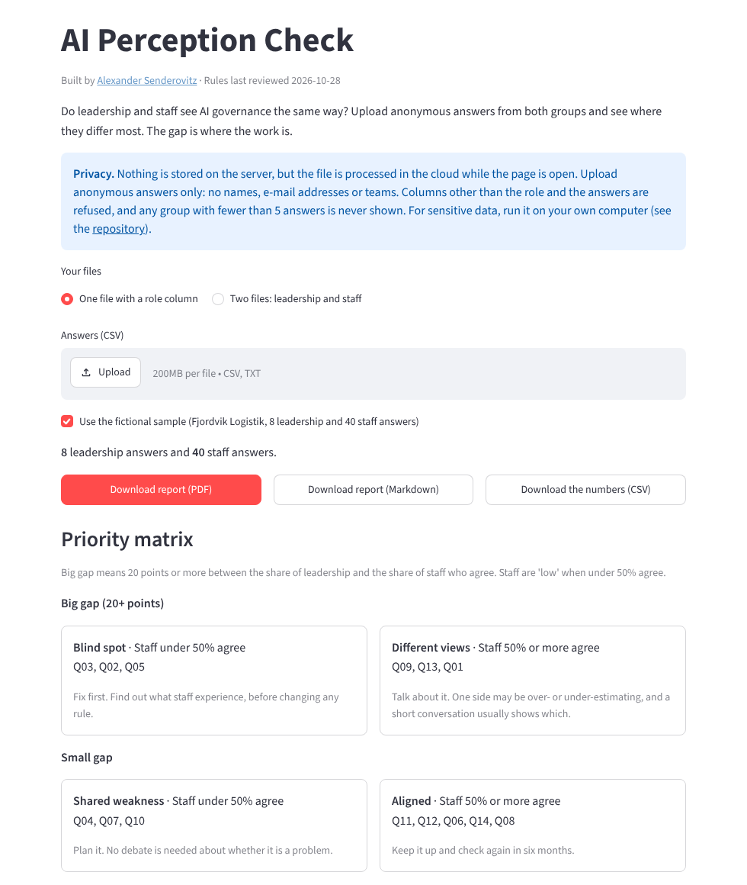

# AI Perception Check

[](https://github.com/gifmaster/ai-perception-check/actions/workflows/tests.yml)
[](https://ai-perception-check.streamlit.app)

**Do leadership and staff see AI governance the same way? Find the gap, and start there.**

A policy can be perfect on paper and still not reach the people who use AI every day. This tool compares anonymous answers from leadership and from staff, statement by statement, and shows where they differ most:

- **A fixed questionnaire** of 14 plain statements on awareness, policy, shadow AI, training, oversight, and trust and speaking up, to paste into any form tool
- **The gap per statement**: the share of leadership who agree minus the share of staff who agree, in percentage points
- **A 2x2 priority matrix**: big or small gap, against whether staff mostly agree. Blind spots come first
- **A PDF report** to share, or Markdown to edit, and the numbers as CSV



**[Try it live](https://ai-perception-check.streamlit.app)** with a fictional logistics company, 8 leadership and 40 staff answers.

## How it works

1. Ask the same [14 statements](src/perceptioncheck/rules/questions.yaml) of leadership and staff. Download the questionnaire and a CSV template from the app.
2. Export the answers as CSV: a `role` column (`leadership` or `staff`, Danish `ledelse` or `medarbejder` also works) and the columns `q01` to `q14`, answered 1 to 5. Or upload two files, one per group.
3. Read the matrix. Each statement lands in one of four places:

| | Staff mostly do not agree (under 50%) | Staff mostly agree (50% or more) |
|---|---|---|
| **Big gap (20 points or more)** | **Blind spot.** Fix first | **Different views.** Talk about it |
| **Small gap** | **Shared weakness.** Plan it | **Aligned.** Keep it up |

Agree means an answer of 4 or 5. The tool compares the share who agree, not only averages, because 1 to 5 answers are ordered categories, not measurements. A gap in either direction counts: if staff are far more positive than leadership, that is worth a conversation too.

## Privacy by design

- Only a role and the answers are read. **Every other column is refused**, with a clear message, so names, e-mail addresses, teams and timestamps cannot slip in. A cell containing an `@` is refused too.
- **A group with fewer than 5 answers is never shown.** Nothing is calculated, and the app says why. The same goes for a single statement answered by fewer than 5 people in a group.
- Nothing is stored. The file is processed in memory while the page is open. On Streamlit Cloud that is still someone else's server, so for sensitive data run it on your own computer (below).
- The report and the CSV hold figures per statement only, never individual answers.

## Run it yourself

```bash
git clone https://github.com/gifmaster/ai-perception-check
cd ai-perception-check
pip install -r requirements.txt
streamlit run app.py
```

As a library:

```python
from perceptioncheck import Rules, analyse, parse_responses, to_markdown

rules = Rules.builtin()
result = analyse(parse_responses(open("answers.csv", "rb").read(), rules), rules)
print(to_markdown(result, "My organisation"))
```

## Trust

- **The rules are plain text.** Wording, thresholds and quadrants are in [`rules/questions.yaml`](src/perceptioncheck/rules/questions.yaml). The arithmetic uses exact fractions, so a gap of exactly 20 points is never lost to rounding (0.8 minus 0.6 is not exactly 0.2 in floating point).
- **The answer key was worked out by hand** from the answer counts in [`scripts/make_samples.py`](scripts/make_samples.py), before the tool was run: [`tests/ground_truth.yaml`](tests/ground_truth.yaml). One hand-worked average (q07, staff) was wrong in the key. The tool was right, and the key now says what happened.
- **A held-out file in a different style** (semicolons, a byte order mark, Danish role words, capitalised headers, two gaps exactly on the threshold, staff agreement exactly on 50%) had its key written before the first run: [`tests/holdout_truth.yaml`](tests/holdout_truth.yaml). It passed on the first run. This is a calculator, so passing says the arithmetic and file reading are right. It says nothing about whether the statements measure what matters.
- 80 tests, including the PDF saying exactly what the Markdown report says. Details in [docs/METHOD.md](docs/METHOD.md).

## Limits

- **It shows how people see things, not how things are.** A gap is a reason to talk, not a finding of fact.
- **The questionnaire is not a validated survey instrument.** The 14 statements were written for this tool and are a starting point. Reword them if your context needs it, but ask leadership and staff the same wording.
- **Only people who answer are counted**, so the picture can be skewed. Small numbers of answers make every figure shaky.
- **All statements are worded so that agreeing is the good answer.** People tend to agree with statements. The matrix compares two groups on the same wording, which cancels much of that, but not all.
- Not an HR, audit or legal assessment.

## Part of a toolkit

The [Practical AI Governance Framework](https://github.com/gifmaster/ai-governance-framework) is the method. Alongside this: the [EU AI Act Risk Check](https://github.com/gifmaster/ai-act-risk-check), the [AI Contract Clause Checker](https://github.com/gifmaster/contract-clause-checker), the [AI Use Case Register](https://github.com/gifmaster/ai-use-case-register) and the [Regulation Navigator](https://github.com/gifmaster/regulation-navigator).

## Licence

AGPL-3.0-only. Free to use, also commercially. If you run a modified version as a service, you must publish your changes. A commercial licence without that condition is available on request: alexander@senderovitz.eu. Fonts are under their own licence, see [NOTICE](NOTICE).

Built by [Alexander Senderovitz](https://senderovitz.eu).
